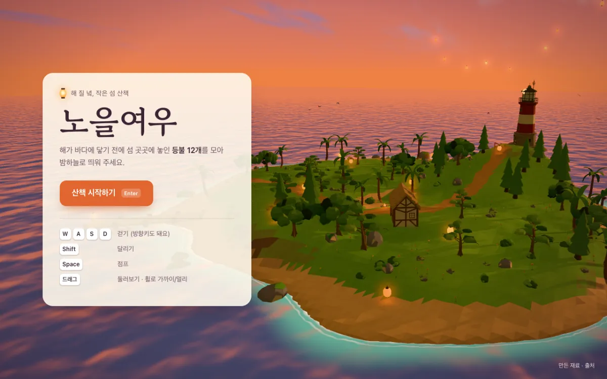

# 노을여우 (Noeul Fox)

해가 바다에 닿기 전에, 작은 섬 곳곳에 놓인 **등불 12개**를 모아 밤하늘로 띄우는 브라우저 3D 게임이에요. 한 판 1~2분.

**바로 해 보기 → https://bnzinc.github.io/game-3d-example/**

> [QuestiVibe](https://github.com/BNZinc) 스타터 `game-3d`로 만든 예시예요. 개발 지식 없이도 "이런 게임 만들어 줘"라고 말하면 에이전트가 만드는 데스크톱 앱이에요. 이 저장소를 **fork**해서 마음대로 고쳐 보세요.



## 조작
| 키보드 | 마우스 | 터치 |
|---|---|---|
| WASD·방향키 걷기 · Shift 달리기 · Space 점프 · Enter 시작 · Esc/P 멈춤 | 드래그로 둘러보기 · 휠로 가까이/멀리 | 왼쪽 반 조이스틱 · 오른쪽 반 드래그 · 점프 버튼 |

`?attract=1` — 글자 없이 섬만 천천히 도는 화면(썸네일용) · `?hq=1` — 늘 최고 화질.

## 내 것으로 가져가기 (fork)
터미널 없이도 돼요.
1. 이 페이지 오른쪽 위 **Fork** → **Create fork**. 내 GitHub에 복사본이 생겨요.
2. 내 복사본에서 **Actions** 탭 → **I understand my workflows, go ahead and enable them**. (fork는 처음에 꺼져 있어요.)
3. **Settings › Pages › Build and deployment › Source**를 **GitHub Actions**로 → **Actions** 탭에서 **Pages › Run workflow**. 1~2분 뒤 `https://<내 아이디>.github.io/game-3d-example/`에서 열려요.
4. 고치고 싶으면: 초록 **Code › Download ZIP**으로 받아 풀고, QuestiVibe에서 **[이미 있는 폴더 열기]**로 그 폴더를 열어 "여우를 고양이로 바꿔 줘"처럼 말하면 돼요.

## 직접 돌려 보기
Node 22 이상과 pnpm이 있으면:

```bash
pnpm install
pnpm dev          # 개발 (http://127.0.0.1:5173)
pnpm build        # dist/ 만들기
pnpm start        # dist/를 PORT(기본 3000)로 내보내기 — Railway 등에 그대로
```

- GitHub Pages: fork한 저장소의 Settings › Pages › Source를 **GitHub Actions**로 두면 `.github/workflows/pages.yml`이 올려요.
- 코드: `src/`(three.js + TypeScript), 화면 글자: `index.html`, 모델: `public/assets/`.
- 에이전트용 안내는 `AGENTS.md` (QuestiVibe에서 열면 에이전트가 이걸 읽어요).

## 라이선스 · 출처
- **코드: MIT** (`LICENSE`). 아래 표의 에셋은 각자의 라이선스를 따라요.
- 3D 모델은 Polyfork의 무료 모델을 **CC BY 4.0**으로 써요(Polyfork 자체 라이선스가 아님). 출처 줄은 `CREDITS.md`, 모델 옆 `public/assets/CREDITS.txt`, 게임 안 **[만든 재료 · 출처]**에 있어요. Polyfork가 이 게임을 만들거나 보증한 것은 아니에요.
- 재배포가 금지된 에셋(예: FreePixel 파일)은 이 저장소에 넣지 않았어요.

| 에셋 | 출처 | 라이선스 | 재배포 |
|---|---|---|---|
| `public/assets/fox.glb` | Fox — Polyfork (https://polyfork.dev/asset/fox-base) | CC BY 4.0 | 예 (출처 표기·고쳤으면 표시) |
| `public/assets/palm.glb` | Palm Tree — Polyfork (https://polyfork.dev/asset/palm-tree-a307da) | CC BY 4.0 | 예 (출처 표기·고쳤으면 표시) |
| `public/assets/cherry.glb` | Cherry Tree — Polyfork (https://polyfork.dev/asset/cherry-tree-a710a9) | CC BY 4.0 | 예 (출처 표기·고쳤으면 표시) |
| `public/assets/pine.glb` | Sculpted Pine — Polyfork (https://polyfork.dev/asset/sculpted-pine-e45d4f) | CC BY 4.0 | 예 (출처 표기·고쳤으면 표시) |
| `public/assets/bush.glb` | Round Bush — Polyfork (https://polyfork.dev/asset/round-bush-cd2ac0) | CC BY 4.0 | 예 (출처 표기·고쳤으면 표시) |
| `public/assets/rock.glb` | Field rock — Polyfork (https://polyfork.dev/asset/field-rock-5e37c6) | CC BY 4.0 | 예 (출처 표기·고쳤으면 표시) |
| `public/assets/rock-small.glb` | Garden Rock — Polyfork (https://polyfork.dev/asset/garden-rock-2d3b51) | CC BY 4.0 | 예 (출처 표기·고쳤으면 표시) |
| `public/assets/lighthouse.glb` | Old Lighthouse — Polyfork (https://polyfork.dev/asset/old-lighthouse-48ca6c) | CC BY 4.0 | 예 (출처 표기·고쳤으면 표시) |
| `public/assets/cottage.glb` | Thatched Cottage — Polyfork (https://polyfork.dev/asset/thatched-cottage-0e63f5) | CC BY 4.0 | 예 (출처 표기·고쳤으면 표시) |
| `public/assets/boat.glb` | Wooden Rowboat — Polyfork (https://polyfork.dev/asset/wooden-rowboat-916981) | CC BY 4.0 | 예 (출처 표기·고쳤으면 표시) |
| `public/assets/pier.glb` | Pier Deck Section — Polyfork (https://polyfork.dev/asset/pier-deck-section-7047d7) | CC BY 4.0 | 예 (출처 표기·고쳤으면 표시) |
| `public/assets/campfire.glb` | Campfire — Polyfork (https://polyfork.dev/asset/campfire-4390aa) | CC BY 4.0 | 예 (출처 표기·고쳤으면 표시) |
| `public/assets/flower.glb` | Wildflower — Polyfork (https://polyfork.dev/asset/wildflower-68d3a1) | CC BY 4.0 | 예 (출처 표기·고쳤으면 표시) |
| `public/assets/fir.glb` | Tall Pine Tree — Polyfork (https://polyfork.dev/asset/tall-pine-tree-ab4108) | CC BY 4.0 | 예 (출처 표기·고쳤으면 표시) |
| 하늘·바다·섬 땅·등불·반딧불·효과 (`src/`) | 직접 만듦 (코드로 그림) | MIT (이 저장소) | 예 |
| 소리 (`src/audio.ts`) | 직접 만듦 (WebAudio로 그 자리에서 만듦, 파일 없음) | MIT (이 저장소) | 예 |
| 제목 글꼴 Gowun Batang | Google Fonts에서 실행할 때 받음 (저장소에 파일 없음) | SIL OFL 1.1 | 저장소에 넣지 않음 |
| 에이전트 스킬 (`.agents/skills/`) | arjun988/blender-skills @904f095 | MIT (각 폴더 LICENSE·NOTICE.md) | 예 (LICENSE 유지) |
| `public/og.webp` (README 그림) | 이 게임 화면을 찍은 것 (Polyfork 모델이 보임) | 화면 속 모델은 CC BY 4.0 (출처 위와 같음) | 예 (출처 표기) |

---

**English:** A tiny three.js game — collect 12 lanterns on a sunset island before the sun sets. Made with the QuestiVibe `game-3d` starter. Code is MIT; the 3D models are by Polyfork under CC BY 4.0 (credits in `CREDITS.md` and `public/assets/CREDITS.txt`). Play: https://bnzinc.github.io/game-3d-example/
